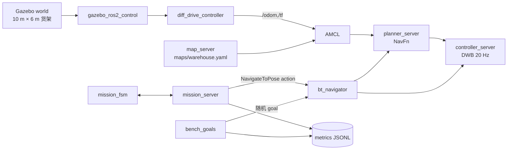

# ROS 2 Warehouse AMR

**仓储自主移动机器人（AMR）软件栈：Nav2 导航 + 任务状态机 + 可复现基准。**
ROS 2 Humble · Gazebo Classic · 差速底盘 · 一条命令起全栈。

[](https://github.com/cccjj55/ros2-warehouse-amr/actions/workflows/ci.yml)
[](https://docs.ros.org/en/humble/)
[](LICENSE)
[](warehouse_amr_mission/test)

<!-- 录一段 20 秒 GIF 放在这里，转化率最高的位置，做法见 docs/DEMO.md -->
<!--  -->

> **状态 / Status**
> 仿真链路已验证（Gazebo Classic + Nav2 Humble，CI 每次构建并解析全部 launch）。
> 真实底盘集成进行中：`ros2_control` 硬件插件用的是社区包 `diffdrive_arduino`，
> 尚未在本仓库内完成实车验证，因此这里**不发布任何实车指标**。
> 上游派生文件与原创文件的边界见 [`NOTICE.md`](NOTICE.md)。

---

## 这是什么

大多数 ROS 2 导航仓库停在"能跟着教程跑起来"。这个仓库补的是后面那半段：**任务怎么被调度、
失败怎么被处理、结果怎么被度量**。

三个自研部分（其余全部复用官方栈，见"边界"一节）：

| 模块 | 文件 | 说明 |
| --- | --- | --- |
| 任务状态机 | [`mission_fsm.py`](warehouse_amr_mission/warehouse_amr_mission/mission_fsm.py) | 显式迁移表 + 重试预算 + 超时看门狗，**零 ROS 依赖**，24 个单测覆盖全分支 |
| 任务执行器 | [`mission_server.py`](warehouse_amr_mission/warehouse_amr_mission/mission_server.py) | Nav2 `NavigateToPose` 异步链接力，不阻塞 executor，状态迁移以 JSON 发布 |
| 基准工具 | [`bench_goals.py`](warehouse_amr_mission/warehouse_amr_mission/bench_goals.py) + [`metrics.py`](warehouse_amr_mission/warehouse_amr_mission/metrics.py) | 随机目标压测 → JSONL/JSON → README 表格，成功率可当 CI 门禁 |

## 30 秒跑起来

```bash
# 依赖：Ubuntu 22.04 + ROS 2 Humble + Gazebo Classic
sudo apt install -y ros-humble-navigation2 ros-humble-nav2-bringup \
                    ros-humble-slam-toolbox ros-humble-twist-mux \
                    ros-humble-ros2-control ros-humble-ros2-controllers \
                    ros-humble-gazebo-ros-pkgs

git clone https://github.com/cccjj55/ros2-warehouse-amr.git ~/ros2_ws/src/ros2-warehouse-amr
cd ~/ros2_ws && colcon build --symlink-install && source install/setup.bash

ros2 launch warehouse_amr_description bringup_sim.launch.py     # Gazebo + AMCL + Nav2 + RViz
ros2 launch warehouse_amr_mission mission.launch.py             # 跑 3 个 demo 配送任务
```

容器：

```bash
docker build -f docker/Dockerfile -t warehouse-amr:humble .
docker run --rm -it warehouse-amr:humble ros2 launch warehouse_amr_description bringup_sim.launch.py gui:=false rviz:=false
```

其他目标：`make help`（`make unit` 单测 / `make bench` 压测 / `make table` 刷新本文表格 / `make map` 重生成示例地图）。

## 系统架构



细版节点图、坐标系约定、状态迁移表见 [`docs/ARCHITECTURE.md`](docs/ARCHITECTURE.md)。

## 实现了什么 / 没实现什么

| 能力 | 状态 | 证据 |
| --- | --- | --- |
| 差速底盘 URDF/Xacro + ros2_control 仿真 | ✅ | `warehouse_amr_description/description/` |
| 仓储世界（货架 / 通道 / 充电座） | ✅ | `worlds/warehouse.world` |
| Nav2 定位 + 规划 + 控制（Humble 参数） | ✅ | `config/nav2_params.yaml` |
| 建图模式（slam_toolbox 异步） | ✅ | `launch/slam_launch.launch.py` |
| 任务状态机（重试 / 超时 / 失败原因） | ✅ | `mission_fsm.py` + 24 单测 |
| 端到端随机目标压测 + 指标落盘 | ✅ | `bench_goals.py`, `metrics.py` |
| CI（构建 + launch 解析 + 单测） | ✅ | `.github/workflows/ci.yml` |
| 地图 | ⚠️ 合成示例图 | `maps/` 由 `scripts/make_demo_map.py` 生成，**不是**建图产物；真实建图命令见 `docs/BENCHMARK.md` |
| 实车验证 | ❌ 未完成 | 硬件插件为社区包，无实车指标 |
| 动态障碍物（行人/叉车） | ❌ 未实现 | Roadmap v0.3 |
| IMU / EKF 里程计融合 | ❌ 未实现 | Roadmap v0.3 |
| 多机调度 | ❌ 未实现 | Roadmap v0.4 |
| 自动充电对接 | ❌ 未实现 | Roadmap v0.5 |

## Benchmark（可复现）

<!-- BENCH:START -->
| 指标 / metric | 值 / value |
| --- | --- |
| 任务数 missions | — |
| 成功率 success rate | — |
| 单任务耗时 mean | — |
| 单任务耗时 P50 | — |
| 单任务耗时 P95 | — |
| 导航目标数/任务 mean | — |
| 重试次数合计 retries | — |
| 失败原因 failure reasons | — |
<!-- BENCH:END -->

> 表格由 `make bench`（跑 25 个随机目标）→ `make table` 自动写入，数据源是
> `docs/benchmarks/latest.json`。本表当前为空，因为仓库里还没有提交基准运行结果——
> **在拿到真实数据前，这里不会出现任何估算值。**
>
> 口径（写论文/汇报都按这个说）：一个 goal 从 `NavigateToPose` 发出到返回
> `STATUS_SUCCEEDED` 记为成功；超时、取消、被拒都算失败并分原因统计；n、P50/P95、
> 环境（仿真 real-time factor / 硬件型号）一起报。详见 [`docs/BENCHMARK.md`](docs/BENCHMARK.md)。

## 仓库结构

```
ros2-warehouse-amr/
├── warehouse_amr_description/        # CMake 包：机器人描述 + 世界 + 地图 + Nav2 参数 + launch
│   ├── description/                  #   URDF/Xacro（底盘、LiDAR、深度相机、ros2_control）
│   ├── config/                       #   nav2_params.yaml（Humble 官方模板 + 本车 delta）、控制器、twist_mux、RViz
│   ├── launch/                       #   launch_sim / bringup_sim / navigation_launch / slam_launch / rsp / launch_robot
│   ├── worlds/warehouse.world        #   货架 + 通道 + 充电座，与地图同坐标系
│   └── maps/warehouse.{yaml,pgm}     #   合成示例图（脚本生成，非建图产物）
├── warehouse_amr_mission/            # Python 包：任务层 + 度量层
│   ├── warehouse_amr_mission/
│   │   ├── mission_fsm.py            #   状态机（无 ROS 依赖）
│   │   ├── mission_server.py         #   Nav2 action 调度 + JSON 状态发布
│   │   ├── bench_goals.py            #   随机目标压测
│   │   └── metrics.py                #   记录 / 聚合 / 渲染 README 表格
│   └── test/                         #   24 个单测（pytest，无需 ROS）
├── scripts/                          # make_demo_map.py, render_bench_table.py
├── docs/                             # ARCHITECTURE / BENCHMARK / DEMO / INTERVIEW_QA / ROADMAP
├── docker/                           # 可复现构建
└── Makefile                          # build / unit / sim / bench / table / map
```

## 工程决策（面试里真正会被追问的部分）

**1. 导航栈包装官方 `nav2_bringup`，不自己维护节点列表。**
旧版是手抄的 Foxy launch（`nav2_recoveries/recoveries_server`、`default_bt_xml_filename`、
`navigate_w_replanning_and_recovery.xml`），在 Humble 上一个都起不来，且没有 `map_server`/`amcl`。
现在 `launch/navigation_launch.py` 只做参数覆写，版本漂移交给上游，diff 可审查。

**2. 状态机与 ROS 解耦。**
`mission_fsm.py` 只依赖 `enum`/`dataclasses`，因此重试预算、超时、非法事件这些最容易写错的
分支能在 0.2 秒内跑完 24 个用例。ROS 层只负责"把 action 结果翻译成事件"。

**3. 异步链接力，不阻塞 executor。**
`send_goal_async → get_result_async → callback` 串起来，另配 1 Hz 看门狗；任何一步挂住，
超时分支仍然可达。（反面教材：在定时器里 `spin_until_future_complete`，Nav2 一慢就死锁。）

**4. 指标产出链固定为"跑 → JSONL → 聚合 → README 表格"。**
`metrics.py` 是纯标准库，CI 里能跑；README 的数字带 `commit sha` 和环境列，
避免"改了参数没重测就改 README"。

**5. 参数文件从上游模板重生成，改动写在文件头。**
`config/nav2_params.yaml` 顶部列了 4 处 delta（`robot_radius`、`max_vel_x`、`xy_goal_tolerance`、
AMCL 初始位姿）。下次同步上游时不用猜。

## Roadmap

见 [`docs/ROADMAP.md`](docs/ROADMAP.md)：v0.3 动态障碍 + EKF → v0.4 多机任务分配 →
v0.5 自动充电对接 → v1.0 实车与策略接口（VLA 子目标接入点）。

## 边界与致谢

- **原创**：`warehouse_amr_mission/**`、`launch/{launch_sim,bringup_sim,navigation_launch,slam_launch,launch_robot}.launch.py`、
  `config/nav2_params.yaml`、`worlds/`、`maps/`、`scripts/`、`docs/`、`docker/`、CI。
- **派生自** [articubot_one](https://github.com/joshnewans/articubot_one)（Josh Newans, MIT）：
  `description/*.xacro`、`rsp/joystick/camera` launch 骨架、`my_controllers.yaml`、RViz 布局。
  逐文件清单见 [`NOTICE.md`](NOTICE.md)，原版权声明保留在 [`LICENSE`](LICENSE)。
- 导航/建图/控制本体属于 [Nav2](https://github.com/ros-navigation/navigation2) 与
  [slam_toolbox](https://github.com/SteveMacenski/slam_toolbox)，本仓库提供的是参数、集成与任务层。

## 作者

**陈泽一 (Chen Zeyi)** · 中南大学 → 浙江大学（机械工程，2026 级）
issues / PR 都看，复现不了的环境问题请附 `ros2 doctor --report`。
