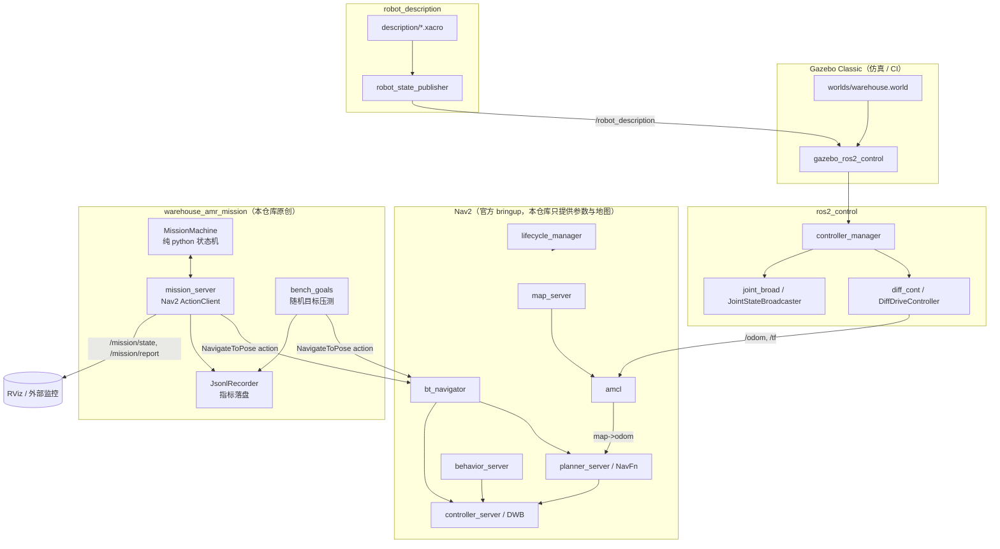

# Architecture

一句话：**感知/定位/规划全部交给 Nav2 与 slam_toolbox，本仓库真正自己写的是「任务层」和「可复现的度量层」。**

这个划分是有意为之。面试里被追问"你写了什么"，答案必须是可指认的文件，而不是"整条导航链路"。

## 1. 运行时节点图

关键点：

- `mission_server` **不产生速度指令**，它只发 Nav2 action。速度控制权始终在 `controller_server`，避免两条控制链打架（旧版本靠 `twist_mux` 优先级兜底，容易在调试时出现"机器人莫名不动"）。
- FSM 与 ROS 解耦，因此 90% 的决策逻辑能在 0.2 秒内跑完 CI（`make unit`，24 个用例）。

## 2. 任务状态机

| 当前状态 | 事件 | 目标状态 | 备注 |
| --- | --- | --- | --- |
| IDLE | ASSIGN | GO_TO_PICK | 派发第一段航点 |
| IDLE | ABORT | IDLE | 无任务，空操作 |
| GO_TO_PICK | NAV_OK | PICKING | 到达取货点 |
| GO_TO_PICK | NAV_FAIL / TIMEOUT | GO_TO_PICK | 计数失败，未超预算则重试 |
| GO_TO_PICK | ABORT | FAILED | 人工取消 |
| PICKING | PICK_OK | GO_TO_DROP | 取货完成（仿真用定时器模拟） |
| PICKING | PICK_FAIL | GO_TO_PICK | 回退到取货段 |
| PICKING | TIMEOUT / ABORT | FAILED | |
| GO_TO_DROP | NAV_OK | DONE | 放货完成 |
| GO_TO_DROP | NAV_FAIL / TIMEOUT | GO_TO_DROP | 重试 |
| DONE / FAILED | RESET | IDLE | 交给下一个任务 |

重试预算 `max_nav_retries` 是**每段航点**的额外尝试次数：`max_nav_retries=2` 意味着单段最多发 3 个 goal。超过预算即 `FAILED`，并记录 `note`（`nav_failed` / `timeout` / `aborted`），这个 `note` 就是 README 表格里"失败原因"列的来源。

## 3. 为什么这版能在 Humble 上起来（旧版不能）

| 项 | 旧版 | 现在 |
| --- | --- | --- |
| controller spawner | `spawner.py`（Humble 无此可执行） | `spawner` |
| 导航启动 | 手抄 Foxy 节点列表：`nav2_recoveries/recoveries_server`、`default_bt_xml_filename`、`navigate_w_replanning_and_recovery.xml` | 包装 `nav2_bringup/bringup_launch.py` |
| 地图 | 无 map_server、无 map 文件 | `maps/warehouse.yaml` + AMCL 初始位姿 |
| 世界 | launch 里没有 `world` 参数，README 却写 `world:=warehouse` | `worlds/warehouse.world` + `world:=` 参数 |
| 参数文件 | Foxy 参数（`amcl_map_client`、`recoveries_server`） | 由 `nav2_bringup` Humble 官方模板重生成，改动列在文件头 |
| 任务层 | README 声称有，代码不存在 | `warehouse_amr_mission` 包 + 24 个单测 |

## 4. 坐标系与单位约定

- 地图：10 m × 6 m，`resolution: 0.05`，`origin: [0, 0, 0]`，占位：`255` 自由 / `0` 占据（`maps/warehouse.pgm`）。
- 世界与地图**共用同一套坐标**，因此 AMCL 初始位姿可以硬编码为 `(0.9, 0.6, 0)`；换真实建图后必须删掉 `nav2_params.yaml` 里的 `set_initial_pose`。
- 车体：0.335 × 0.265 m 底盘，轮半径 0.033 m，轮距 0.297 m，`base_footprint` 贴地、`base_link` 抬高 0.138 m。costmap 用 `robot_radius: 0.25`（含安全余量），不用 footprint 多边形。

## 5. 度量口径（重要）

`bench_goals` 测的是**端到端导航成功率与耗时**：从发出 `NavigateToPose` 到 action 返回 `STATUS_SUCCEEDED`。

它**不**测：定位误差（需要真值位姿）、轨迹平滑度、能耗、多机调度效率。

因此 README 里不会出现"定位精度 < 3 cm"这类无法由本仓库脚本产出的数字。要写定位误差，就得先有一个真值来源（Gazebo `/gazebo/model_states` 里的真实位姿 vs AMCL `/amcl_pose`），脚本见 `docs/BENCHMARK.md` 的"扩展度量"一节。
